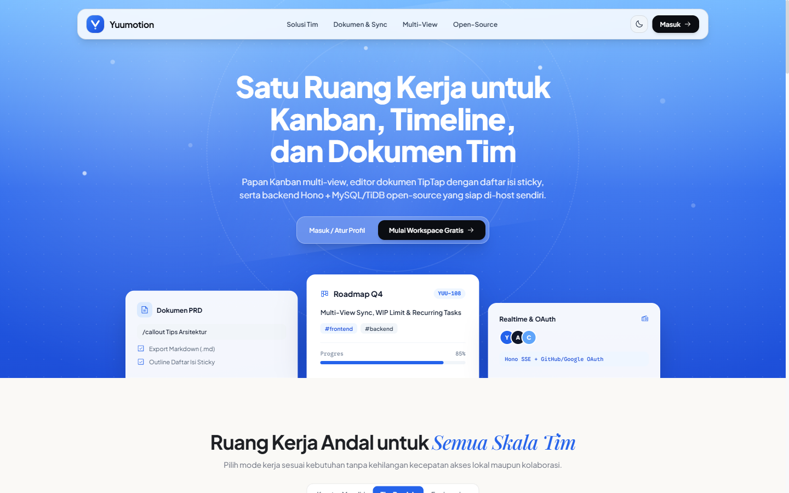
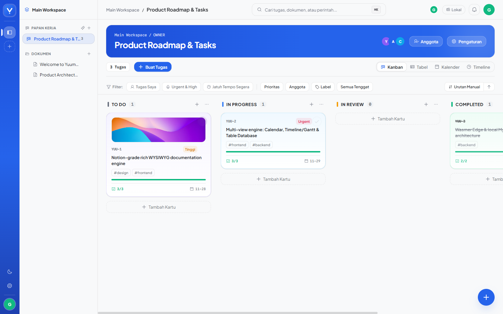
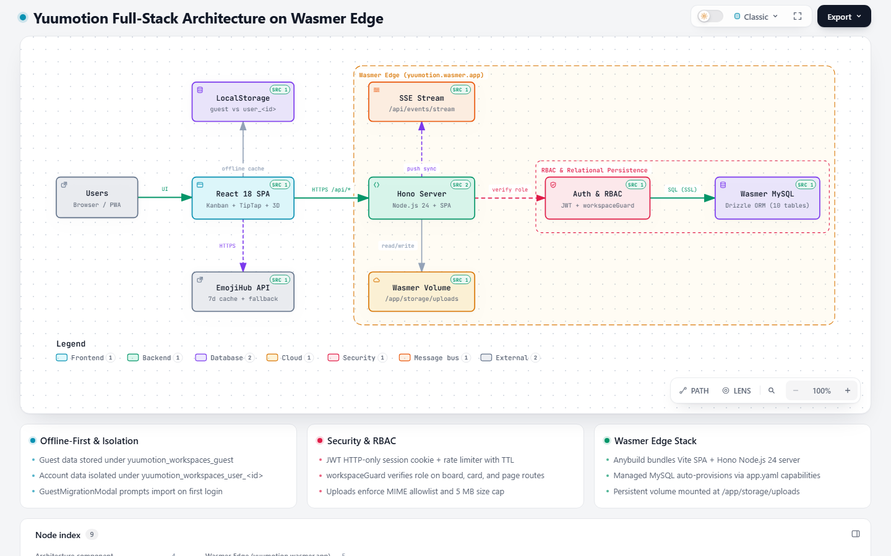

# Yuumotion

Workspace kolaboratif hibrida (**Kanban + Dokumen TipTap + Multi-View Sync**) yang terinspirasi dari ketenangan antarmuka AppFlowy, dibangun dengan arsitektur **offline-first** serta backend **Hono + Drizzle ORM (MySQL)** yang berjalan penuh di **Wasmer Edge**.

> **Live Demo:** [https://yuumotion.wasmer.app](https://yuumotion.wasmer.app)  
> **Lisensi:** [Apache License 2.0](LICENSE)

---

## Preview Aplikasi

### Halaman Utama & Workspace Kanban
| Landing Page | Workspace Multi-View & Filter |
| :---: | :---: |
|  |  |

### Arsitektur Sistem (Archify)
Diagram berikut dihasilkan langsung dari kode sumber menggunakan **Archify** (`showcase` profile):



- Buka diagram HTML interaktif (zoom, inspeksi *source citation*, mode gelap/terang): [yuumotion-architecture.html](.archify/architecture-yuumotion-20261126-095800/yuumotion-architecture.html)
- Baca detail arsitektur di [docs/ARCHITECTURE.md](docs/ARCHITECTURE.md)

---

## Fitur Utama

- **Multi-View Workspace & Filter/Sort Lintas View**
  - Empat tampilan sinkron dalam satu papan: **Kanban Board** (pointer + keyboard DnD, inline edit, WIP limit, reorder kolom), **Tabel Spreadsheet**, **Kalender Bulanan**, dan **Timeline Gantt**.
  - **Filter & Sort Bar** (`FilterSortBar`): filter berdasarkan prioritas, *assignee*, label, tenggat waktu, *preset* cepat (*Tugas Saya*, *Urgent & High*, *Jatuh Tempo Segera*), serta pengurutan dinamis.
- **Multi-Checklist & Sub-tugas Kaya**
  - Mendukung banyak grup checklist per kartu dengan *inline rename*, progress bar per grup, *assignee* & tenggat waktu per item, serta tombol **Jadikan Kartu** untuk mengonversi sub-tugas menjadi kartu Kanban baru.
- **Editor Dokumen TipTap v3 + Nested Sub-pages**
  - Slash commands (`/`), blok **Tabel** (`/tabel` dengan kontrol `+Kolom`, `+Baris`, `Hapus`), daftar isi *sticky*, auto-save indicator, dan export ke Markdown (`.md`).
  - Hierarki dokumen bersarang (*nested sub-pages*) dengan *collapse/expand* di sidebar dan navigasi *breadcrumb*.
- **Notification Inbox & `@mention`**
  - Ikon lonceng notifikasi dengan *unread badge*, tab *Semua* / *Belum Dibaca*, dan navigasi langsung ke kartu/dokumen terkait.
  - Autocomplete `@mention` pada komentar aktivitas kartu serta *SSE realtime stream* (`/api/events/stream`).
- **Isolasi Storage Guest vs Akun & Keamanan**
  - Data sesi tamu (`yuumotion_workspaces_guest`) terisolasi penuh dari data akun terdaftar (`yuumotion_workspaces_user_<id>`), lengkap dengan `GuestMigrationModal` saat login pertama kali.
  - Otorisasi berbasis *workspace role* (`workspaceGuard`), JWT HTTP-only cookie, *rate limiter* dengan TTL pruning, dan validasi MIME + ukuran pada unggahan file.

---

## Tech Stack

| Lapisan | Teknologi |
| :--- | :--- |
| **Frontend** | React 18, TypeScript, Vite 6, Tailwind CSS, TipTap v3, Three.js, Phosphor Icons |
| **Backend** | Hono (Node.js 24), Drizzle ORM, `mysql2`, `jose` (JWT), `bcryptjs`, Server-Sent Events |
| **Database & Storage** | Wasmer Managed MySQL (auto-schema `ensureSchema()`), Wasmer Persistent Volume (`/app/storage/uploads`) |
| **Deployment** | Wasmer Edge (`Anybuild` + `app.yaml`) |

---

## Struktur Direktori

```text
yuumotion/
├── Anybuild                  # Definisi build Node.js 24 + Hono untuk Wasmer Edge
├── app.yaml                  # Konfigurasi Wasmer Edge (MySQL, Volume, env)
├── shared/
│   └── contracts.ts          # Kontrak tipe data bersama FE & BE
├── src/                      # Aplikasi React 18 + Vite (SPA)
│   ├── components/           # Komponen Kanban, Calendar, Timeline, Table, TipTap, Modal, UI
│   ├── hooks/                # Hook sesi auth & isolasi storage (useAuthSession)
│   ├── lib/                  # Storage namespace, filter kartu, emoji API, sync client
│   └── services/             # HTTP API client (apiClient.ts) & activity logger
├── server/
│   └── src/
│       ├── db/               # Koneksi pool MySQL SSL, schema Drizzle, ensureSchema()
│       ├── middleware/       # Auth JWT, rate limiter, workspaceGuard RBAC
│       └── routes/           # Auth, Workspaces, Boards, Pages, Notifications, Uploads, SSE
└── docs/                     # Dokumentasi arsitektur, desain, sync, & panduan Wasmer
```

---

## Menjalankan Secara Lokal

### 1. Frontend (Mode Offline-First / Guest)
```bash
npm install
npm run dev
```

### 2. Full-Stack (Frontend + Backend Hono + MySQL)
Salin `.env.example` menjadi `.env`, isi `DATABASE_URL` dan `JWT_SECRET`, lalu jalankan:
```bash
npm run db:push
npm run dev:server
```

Untuk build produksi lokal:
```bash
npm run build
npm run build:server
npm start
```

---

## Deploy ke Wasmer Edge

Panduan lengkap konfigurasi `app.yaml`, `Anybuild`, Wasmer Managed MySQL, Persistent Volume, dan rahasia `JWT_SECRET` tersedia di [docs/DEPLOYMENT_WASMER.md](docs/DEPLOYMENT_WASMER.md).

```bash
wasmer deploy --non-interactive --build-remote
```
