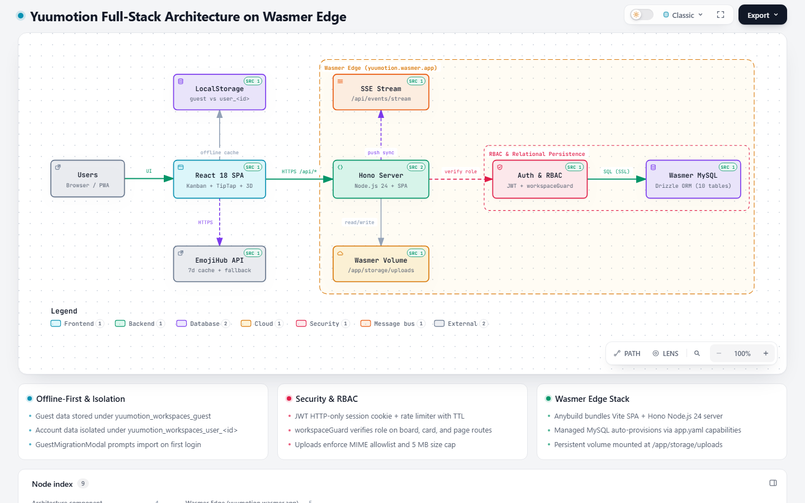

# Arsitektur Yuumotion (Full-Stack Wasmer Edge)

Yuumotion adalah workspace kolaboratif hibrida (**Kanban + Dokumen TipTap + Multi-View**) yang memadukan pengalaman **offline-first** di browser dengan backend **Hono (Node.js 24) + Drizzle ORM + Wasmer Managed MySQL + Wasmer Persistent Volume** dalam satu deployment Wasmer Edge (`https://yuumotion.wasmer.app`).

> Lihat visualisasi diagram interaktif yang dihasilkan dari kode sumber: [yuumotion-architecture.html](../.archify/architecture-yuumotion-20261126-095800/yuumotion-architecture.html)

---

## 1. Gambaran Aliran Sistem

1. **Browser Client (`src/`)**:
   - Aplikasi React 18 + Vite berjalan sebagai SPA dengan persistensi lokal instan di `localStorage`.
   - **Isolasi Storage (`src/lib/storageNamespace.ts` & `src/hooks/useAuthSession.ts`)**: Key `localStorage` dipisahkan antara sesi tamu (`yuumotion_workspaces_guest`) dan akun terdaftar (`yuumotion_workspaces_user_<id>`). Saat pengguna baru login dari mode tamu, `GuestMigrationModal` menawarkan opsi impor workspace tamu atau memulai bersih.
   - **EmojiHub API (`src/lib/emojiApi.ts`)**: Mengambil daftar emoji dengan cache `localStorage` 7 hari dan *fallback* 48 emoji bawaan jika jaringan offline.
2. **Wasmer Edge Server (`server/src/index.ts`)**:
   - Didefinisikan melalui `Anybuild` (provider Node.js 24, `server: Hono`) dan `app.yaml`.
   - Satu proses Node.js (`0.0.0.0:$PORT`) melayani aset statis frontend (`./dist` via `serveStatic` + fallback SPA) sekaligus seluruh endpoint `/api/*` dalam satu origin.
   - **Realtime Sync (`server/src/routes/events.ts`)**: Menyediakan Server-Sent Events (`/api/events/stream`) per workspace untuk menyinkronkan pembaruan papan, kartu, dokumen, dan notifikasi.
3. **Keamanan & Kontrol Akses (`server/src/middleware/`)**:
   - `requireAuth` memverifikasi token JWT HTTP-only cookie (`yuumotion_session`) serta menerapkan *rate limiter* berbasis IP dengan pembersihan TTL otomatis.
   - `authorizeWorkspaceResource` (`workspaceGuard.ts`) menyelesaikan `workspaceId` dari `boardId`, `cardId`, atau `pageId` dan memverifikasi peran minimum anggota (`viewer`, `member`, `admin`, `owner`) sebelum mutasi dijalankan.
4. **Persistensi Data & File (`server/src/db/` & `server/src/routes/uploads.ts`)**:
   - **Wasmer Managed MySQL (`db_792d3f57`)**: Terhubung via `mysql2` pool dengan SSL otomatis saat `DB_HOST` atau `DB_SSL=true` terdeteksi. Saat startup, `ensureSchema()` memastikan 10 tabel inti (`users`, `workspaces`, `workspace_members`, `boards`, `columns`, `cards`, `pages`, `notifications`, `activities`, `uploads`) tersedia.
   - **Wasmer Persistent Volume (`/app/storage/uploads`)**: File lampiran yang lolos allowlist MIME (`image/*`, `application/pdf`, `text/*`) dan batas ukuran 5 MB disimpan ke volume persisten dan disajikan melalui `GET /api/uploads/:id/:fileName` (dengan dukungan opsional `WASMER_STORAGE_ENDPOINT` S3-compatible).

---

## 2. Dokumen Terkait

- [Panduan Deployment Wasmer Edge](DEPLOYMENT_WASMER.md)
- [Sistem Desain & Token Warna](DESIGN_SYSTEM.md)
- [Protokol Sinkronisasi Multi-User](MULTIUSER_SYNC.md)
